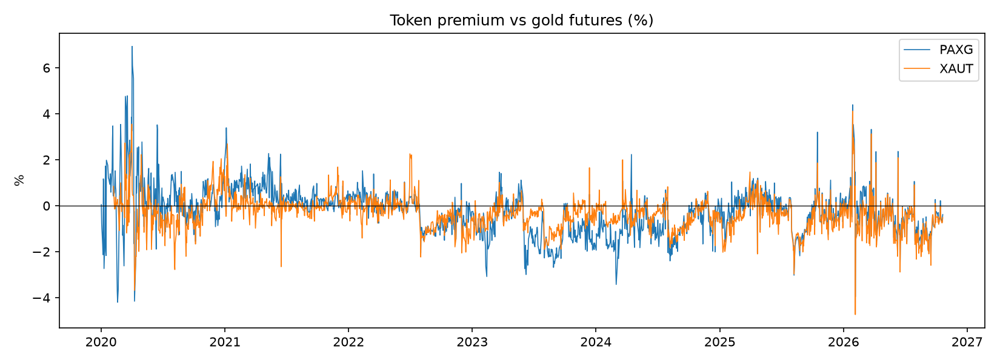
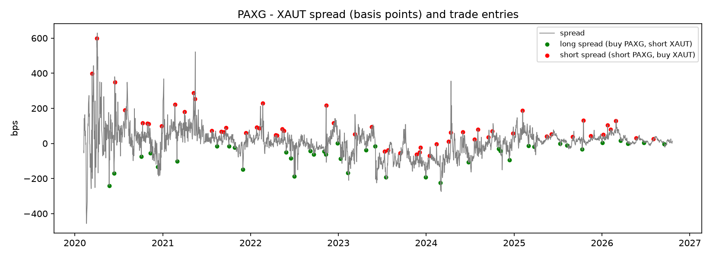
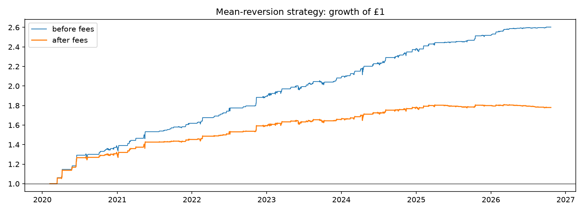

# Tokenised Gold: Tracking Accuracy and Mean-Reversion

Do gold-backed crypto tokens actually track gold, and can you profit when two
of them drift apart?

PAXG (Paxos Gold) and XAUT (Tether Gold) are each backed by one troy ounce of
physical gold, so in theory both should trade at the gold price. This project
measures how closely they do, how quickly gaps between them close, and whether
a mean-reversion strategy on that gap survives transaction costs.

**Data:** daily closes from Yahoo Finance, 2020-02-07 to 2026-10-21
(`PAXG-USD`, `XAUT-USD`, gold futures `GC=F`).

## 1. Tracking accuracy vs gold

| PAXG | |
|---|---|
| days compared | 1,713 |
| mean premium | -0.262% |
| premium st. dev. | 1.054% |
| days >0.5% off gold | 57.852% |
| tracking error (annual) | 12.893% |
| beta | 0.7972 |
| R squared | 0.6071 |

| XAUT | |
|---|---|
| days compared | 1,688 |
| mean premium | -0.355% |
| premium st. dev. | 0.750% |
| days >0.5% off gold | 46.742% |
| tracking error (annual) | 10.638% |
| beta | 0.8018 |
| R squared | 0.7077 |



## 2. PAXG vs XAUT: mean reversion

Spread = ln(PAXG) − ln(XAUT). An ADF test checks for stationarity, and an
AR(1) regression (the discrete form of an Ornstein-Uhlenbeck process) gives the
speed of mean reversion and the half-life of a gap.

| Metric | Value |
|---|---|
| mean spread | 0.081% |
| spread st. dev. | 0.816% |
| ADF statistic | -5.3635 |
| ADF p-value | 0.0000 |
| AR(1) coefficient b | -0.2465 |
| OU speed theta (per day) | 0.2831 |
| half-life (days) | 2.4487 |

## 3. Mean-reversion strategy

Rules: enter when the 30-day z-score of the spread passes ±2, exit
when it returns to 0. Signals are lagged one day (no look-ahead).
Fees: 0.10% per token per trade.

**After fees**

| Metric | Value |
|---|---|
| total return | 78.002% |
| annual return | 8.974% |
| annual volatility | 6.632% |
| Sharpe ratio | 1.2959 |
| max drawdown | -3.957% |
| number of trades | 95 |
| % of days in a trade | 29.563% |

**Before fees**

| Metric | Value |
|---|---|
| total return | 160.289% |
| annual return | 15.324% |
| annual volatility | 6.703% |
| Sharpe ratio | 2.1271 |
| max drawdown | -3.957% |
| number of trades | 95 |
| % of days in a trade | 29.563% |





## Limitations

- Shorting a token requires borrowing it, which has a cost and is not always
  available. Borrow costs are not modelled.
- Daily closing prices miss intraday dislocations, and Yahoo prices are
  aggregated across exchanges, so they may not be achievable fills.
- Gold futures (`GC=F`) are not spot gold: they include carry and roll between
  contracts, which affects the premium level and adds noise to tracking error.
- Crypto closes at 00:00 UTC while gold futures settle in the US afternoon, so
  token-vs-gold daily returns are not perfectly synchronised. The PAXG vs XAUT
  comparison avoids this.

## How to run

```
pip install yfinance pandas numpy statsmodels matplotlib
python gold_token_analysis.py
```
